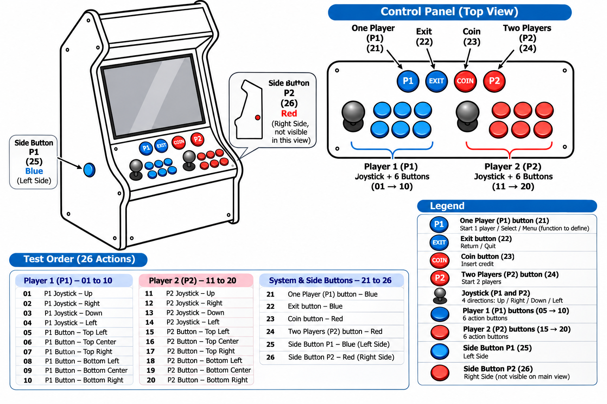

# Mini-PAC and measured control mapping

[Back to the repository overview](../README.md)

## Device and test evidence

The **Ultimarc Mini-PAC**, USB VID/PID **`d209:0440`**, is operating as a keyboard in the Linux capture, with additional mouse/system/consumer-control interfaces. The interface version reported as `0x0111` does not identify the Ultimarc firmware revision.

The original [evtest capture](../evidence/minipac-evtest.txt) was provided by the owner. The tool is **evtest**, not “envtest”. The capture is an input-event test, **not a firmware, EEPROM or WinIPAC configuration dump**.

The physical labels below come from the owner's diagram. The mapping correlates its 01–26 test order with the chronological capture. The raw log contains no embedded physical-button annotations, so this correlation assumes that test order was followed. Two consecutive presses of I were grouped as action 10; key-repeat events (`value=2`) and releases (`value=0`) are not extra actions.



## Mapping

| ID | Physical action | Linux event | evdev code | MSC_SCAN (hex) |
|---:|---|---|---:|---|
| 01 | P1 joystick up | `KEY_UP` | 103 | `0x70052` |
| 02 | P1 joystick right | `KEY_RIGHT` | 106 | `0x7004f` |
| 03 | P1 joystick down | `KEY_DOWN` | 108 | `0x70051` |
| 04 | P1 joystick left | `KEY_LEFT` | 105 | `0x70050` |
| 05 | P1 top-left button | `KEY_M` | 50 | `0x70010` |
| 06 | P1 top-center button | `KEY_W` | 17 | `0x7001a` |
| 07 | P1 top-right button | `KEY_E` | 18 | `0x70008` |
| 08 | P1 bottom-left button | `KEY_R` | 19 | `0x70015` |
| 09 | P1 bottom-center button | `KEY_U` | 22 | `0x70018` |
| 10 | P1 bottom-right button | `KEY_I` | 23 | `0x7000c` |
| 11 | P2 joystick up | `KEY_K` | 37 | `0x7000e` |
| 12 | P2 joystick right | `KEY_KP6` | 77 | `0x7005e` |
| 13 | P2 joystick down | `KEY_O` | 24 | `0x70012` |
| 14 | P2 joystick left | `KEY_P` | 25 | `0x70013` |
| 15 | P2 top-left button | `KEY_A` | 30 | `0x70004` |
| 16 | P2 top-center button | `KEY_F` | 33 | `0x70009` |
| 17 | P2 top-right button | `KEY_L` | 38 | `0x7000f` |
| 18 | P2 bottom-left button | `KEY_N` | 49 | `0x70011` |
| 19 | P2 bottom-center button | `KEY_J` | 36 | `0x7000d` |
| 20 | P2 bottom-right button | `KEY_Z` | 44 | `0x7001d` |
| 21 | P1 / one-player service button (blue) | `KEY_KP1` | 79 | `0x70059` |
| 22 | Exit service button (blue) | `KEY_ESC` | 1 | `0x70029` |
| 23 | Coin / credit service button (red) | `KEY_ENTER` | 28 | `0x70028` |
| 24 | P2 / two-player service button (red) | `KEY_KP2` | 80 | `0x7005a` |
| 25 | P1 left-side button (blue) | `KEY_1` | 2 | `0x7001e` |
| 26 | P2 right-side button (red) | `KEY_5` | 6 | `0x70022` |

[Machine-readable mapping](../metadata/minipac-mapping.csv).

`KEY_KP1`, `KEY_KP2` and `KEY_KP6` are **numeric-keypad** keys. They are not interchangeable with top-row `KEY_1`, `KEY_2` or `KEY_6`. Linux key identifiers also must not be confused with characters displayed by an AZERTY keyboard layout. The later offline Windows-profile audit found Spanish/US layout entries and initial NumLock enabled for `arcade`; this is recorded configuration, not a live Windows confirmation during the input test. See [the reconstruction audit](windows-reconstruction-audit.md).

The Linux inventory associated the main keyboard interface with `/dev/input/event3`, but that number is not stable across boots. To repeat the test under SystemRescue:

```sh
ls -l /dev/input/by-id/
sudo evtest
# Select the keyboard interface named Ultimarc Mini-PAC.
# Then use the stable interface path actually found on this boot:
sudo evtest /dev/input/by-id/<mini-pac-keyboard-interface> | tee minipac-mapping.txt
```

Test actions 01–26 with a release between actions and retain an annotated record of the physical order.

## Windows-wide remapping

The active SYSTEM hive records the following `Scancode Map` in `ControlSet001\Control\Keyboard Layout`:

```text
00 00 00 00 00 00 00 00 02 00 00 00 0f 00 38 00 00 00 00 00
```

It maps **left Alt (0x0038) to Tab (0x000f)**. None of the 26 captured actions emits `KEY_LEFTALT`; therefore this value does not demonstrate a remapping of any of those 26 specific controls. It may matter for other keys or secondary functions. The observed bytes are retained in [registry-observations.json](../config/windows/registry-observations.json).

## MAME's recorded bindings

Sources: [MAME Retro default.cfg](../config/emulators/MAME%20Retro/cfg/default.cfg) and [MAME default.cfg](../config/emulators/MAME/cfg/default.cfg).

| Function | Recorded binding |
|---|---|
| P1 buttons 1–6 | M, W, E, R, U, I |
| P2 joystick up / right / down / left | K, 6PAD, O, P |
| P2 buttons 1–6 | A, F, L, N, J, Z |
| START1 / START2 | 1PAD / 2PAD |
| COIN1 / COIN2 | ENTER / ENTER |
| MAME UI select | ENTER OR M |
| Configure / pause | TAB / 8PAD |
| Save / load state | F5 / F10 |

The file also configures P1 twin-stick commands: `P1_JOYSTICKRIGHT` on the arrow keys and `P1_JOYSTICKLEFT` on K/O/P/6PAD. These are MAME logical names, not cabinet-player labels. Defaults, `ctrlr` profiles and per-game CFG files can further affect the effective result.

HyperSpin's menu Start is recorded as M, while the P1 service button emits keypad 1. See [frontend configuration](frontend.md) for that discrepancy.

## Still unmeasured

Mini-PAC board revision and firmware, terminal wiring, WinIPAC export, shifted functions, multi-button combinations, two-player simultaneous input, bounce and rollover limits. Do not reflash or reprogram the board based solely on this capture. A second annotated test can independently confirm each physical position.
