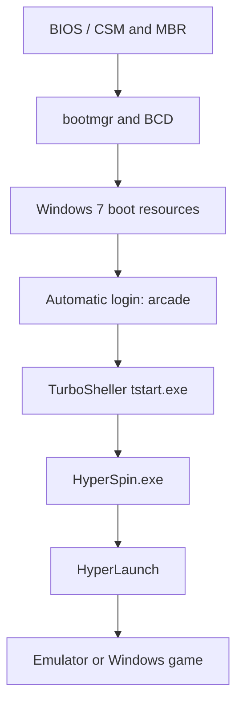

# Original startup and visual customization

[Back to the repository overview](../README.md)

## Startup chain found on disk



Registry observations are retained as [read-only JSON documentation](../config/windows/registry-observations.json), not an executable `.reg` installer. Passwords and activation material are not included.

```text
HKLM\SOFTWARE\Microsoft\Windows NT\CurrentVersion\Winlogon
    Shell = C:\Program Files (x86)\TSheller\tstart.exe
    AutoAdminLogon = "1"
    DefaultUserName = "arcade"

HKLM\SOFTWARE\TurboSheller
    FrontEnd = D:\hyperspin1.0\HyperSpin.exe
```

The AutoHotkey script embedded in `tstart.exe` was inspected without executing it. It reads `FrontEnd` and launches it when `explorer.exe` is not running. It also contains Ctrl+T to open TurboSheller and second-logical-joystick button shortcuts for volume. These are script observations, not proof those shortcuts work with the captured Mini-PAC mode.

This replaces the normal Explorer shell for the configured Windows login. Classic Shell and Realtek audio-control startup entries also exist in the original image.

The additional Startup-folder shortcut and the desktop helper wrappers were also resolved during the [reconstruction audit](windows-reconstruction-audit.md#startup-helper-behavior).

## Replacement Windows boot animation

The active `C:\Windows\System32\bootres.dll` contains an embedded WIM with `activity.bmp`:

- Dimensions: **200×21000 pixels**, 24-bit bitmap.
- 105 frames of 200×200 pixels; 55 distinct pixel-frame hashes.
- The first extracted frame shows a **white Space Invader on black**, rather than the Windows logo.
- Internal WIM timestamps: **2016-11-14**.

The binary and bitmap are deliberately not distributed here. Hashes of the examined files are in [windows-boot-file-hashes.json](../evidence/windows-boot-file-hashes.json).

Different files named `bootres~1.dll`, `bootres~2.dll` and `bootres~3.dll` exist beside the active file. These are stored variants, not certified clean Microsoft originals. `Win7BootUpdater.exe` is present in the private image's TSheller directory: it is the likely customization tool, but no execution log establishes the exact command used.

## Login-screen resources and loaders

- Active `authui.dll` is byte-for-byte identical to `authui_BLACK.dll`, and differs from `authui_original.dll`. This verifies selection of the stored BLACK variant, not the rendered appearance of every login screen.
- Registry `OEMBackground=0`; the usual OEM-background directory was not found. The observed configuration is not simply an enabled OEM wallpaper.
- Active `winload.exe` and `winresume.exe` differ from stored alternatives. Their exact patches have not been established against clean Microsoft files of the same versions.
- Do not infer signature-enforcement changes or BCD flags from file-hash differences alone. BCD settings were not fully decoded in this analysis.

**TBD:** exact loader/resource patch history and runtime confirmation of the full boot/login sequence. These modifications document the existing Windows 7 image; they are not instructions for patching another Windows version.
